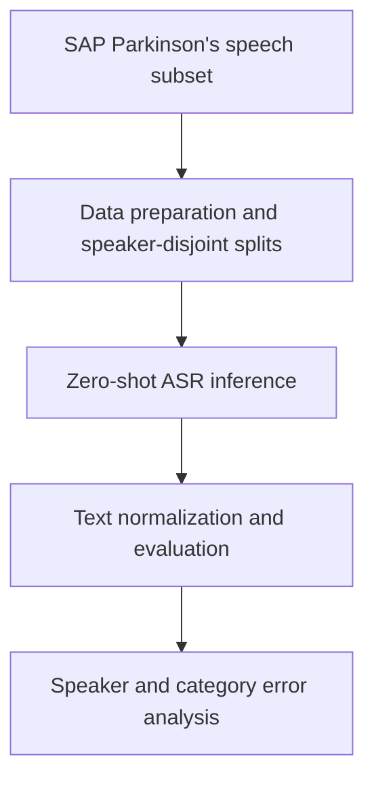

# ASR for Accessibility
### Understanding and improving speech recognition for Parkinson's speech

**Ongoing MScAC applied research project · University of Toronto**

## Project Overview

Speech recognition does not work equally well for everyone. Changes in speaking rate, articulation, and pauses can make speech harder for existing models to transcribe. These errors can limit the usefulness of voice-based tools for people with speech impairments.

This project studies how automatic speech recognition (ASR) performs on speech from people with Parkinson's disease, using the Parkinson's subset of the Speech Accessibility Project (SAP) dataset. The goal is to understand where current models struggle and use that evidence to guide model adaptation.

The work currently focuses on data preparation, zero-shot model evaluation, and error analysis. The next stage will investigate whether training that accounts for speaker difficulty can improve recognition for speakers with higher error rates.

## Current Progress

| Area | Status |
| --- | --- |
| Parkinson's subset preparation and speaker-disjoint splits | Completed |
| Zero-shot validation baselines: Qwen3-ASR-1.7B, Cohere Transcribe, Whisper-small | Completed |
| Per-speaker and speech-category comparisons | Initial analysis completed; further investigation ongoing |
| Training-speaker difficulty estimation | Next stage |
| Fine-tuning and sampling experiments | Planned |
| Final held-out test evaluation of adapted models | Planned |

## Data and Evaluation Design

The prepared dataset separates speakers across training, validation, and test sets. This allows evaluation on speakers who were not included in training.

| Split | Speakers | Recordings |
| --- | ---: | ---: |
| Train | 221 | 91,035 |
| Validation | 25 | 10,733 |
| Test | 35 | 14,487 |

The evaluation pipeline applies text normalization and measures word error rate (WER), character error rate (CER), and substitution, deletion, and insertion errors. Analysis considers both overall performance and variation across speakers and speech categories.

## Pipeline

Planned adaptation experiments will build on this pipeline. Training-speaker difficulty will be estimated using training data; validation and test speakers will not be used as adaptation training examples.

## Preliminary Results

The following results are from zero-shot evaluation on the validation split, before task-specific fine-tuning. Lower WER is better.

| Model | Validation WER | Notes |
| --- | ---: | --- |
| Qwen3-ASR-1.7B | 10.84% | Primary candidate for further adaptation |
| Cohere Transcribe | 12.84% | Additional baseline for cross-model comparison |
| Whisper-small | 35.53% | Repetition hallucinations contributed to errors |

Qwen and Cohere each scored all 10,733 validation recordings. These are preliminary results for the current dataset and inference settings, rather than a general ranking of the models. The Whisper-small result should be interpreted alongside its repetition behavior.

### What the initial analysis suggests

- **Overall WER hides substantial differences between speakers.** A model can perform well on average while remaining unreliable for some speakers.
- **Difficult speakers overlap across models.** In the initial Qwen–Cohere comparison, seven of the eight highest-WER speakers overlapped. This motivates investigating shared failure patterns.
- **Generation behavior matters.** Whisper-small's repeated text highlights the need to inspect predictions and error types alongside aggregate metrics.

These observations guide the next experiments; they do not yet establish the causes of recognition difficulty.

## Next Experiments

1. **Estimate difficulty on training speakers.** Use frozen zero-shot Qwen predictions to identify higher-WER speakers within the training split.
2. **Compare training strategies.** Evaluate uniform sampling, speaker-balanced sampling, and hard-speaker oversampling with ground-truth transcripts.
3. **Investigate adaptation choices.** Explore parameter-efficient fine-tuning and speech-impairment-aware adaptation, with speaker personalization as a possible follow-up.
4. **Evaluate generalization.** Use validation data for model selection and report final adapted-model performance on the speaker-disjoint test set.

The central question is whether adaptation can improve recognition for difficult speakers while maintaining performance across the wider evaluation set.

## Technical Focus

- **Data engineering:** Preparing speech metadata, filtering the Parkinson's subset, and constructing speaker-disjoint manifests.
- **Model evaluation:** Running zero-shot ASR baselines through a common evaluation workflow.
- **Error analysis:** Examining WER, CER, and substitution/deletion/insertion patterns across speakers and speech categories.
- **Adaptation research:** Designing experiments around speaker difficulty and training-data sampling.

The implementation uses Python and model-specific ASR inference libraries.

## Scope and Limitations

This is ongoing research. Adaptation gains have not yet been established, and the results shown here are validation baselines. Performance on this dataset does not establish real-world or clinical effectiveness.

## Source Code and Data

This repository provides a public overview of the project, its current findings, and planned experiments. The full implementation is maintained in a private repository.

Speech recordings, participant identifiers, transcripts, data manifests, and individual prediction outputs are not distributed here.

